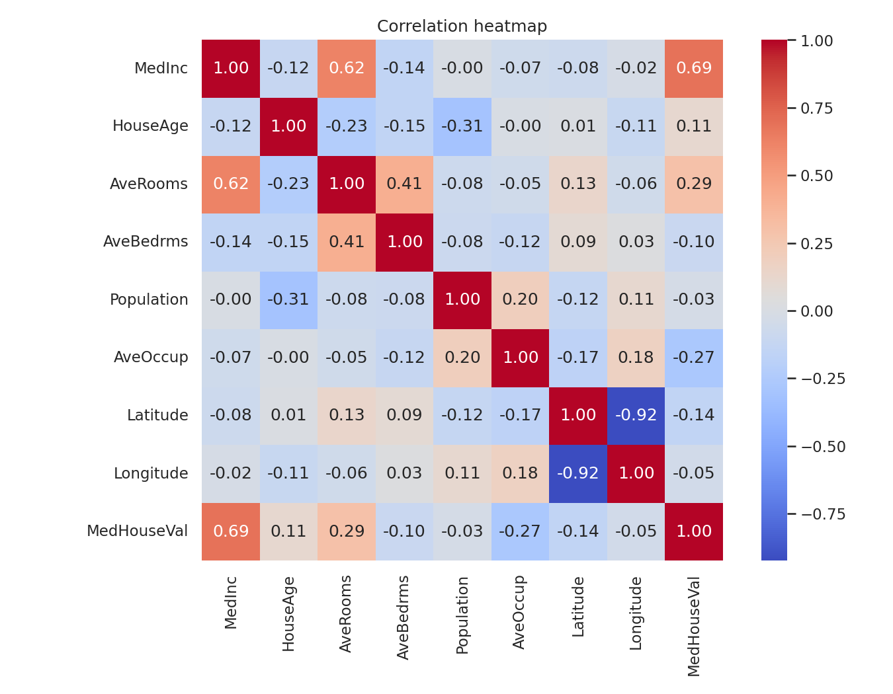
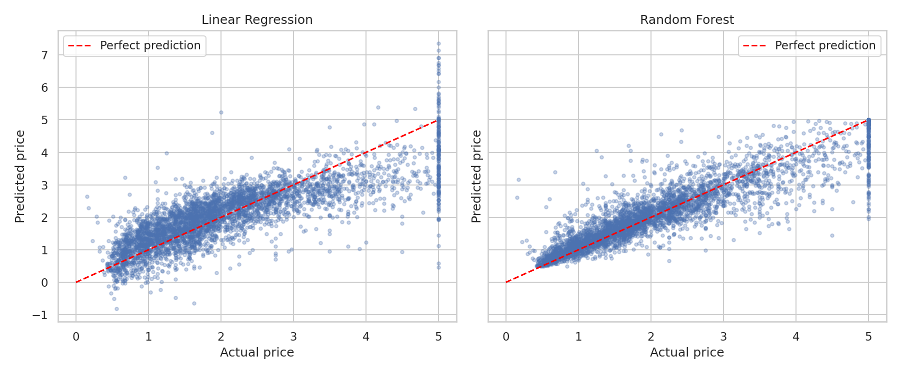
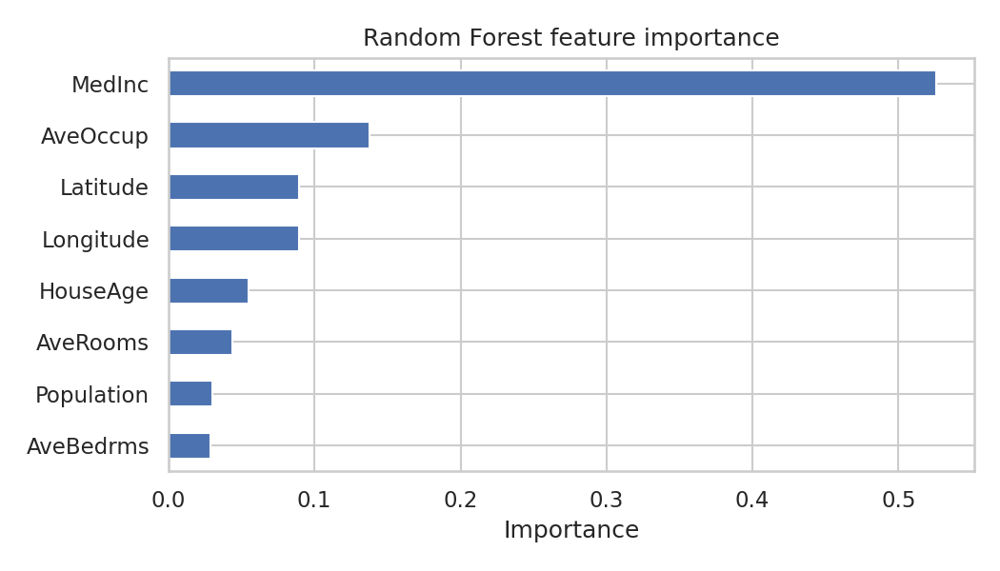

# House Price Prediction using Machine Learning

A beginner-friendly machine learning project that predicts house prices in California with regression models. It covers the full workflow: loading data, cleaning, exploratory analysis, training, evaluation and comparison of two models.

## Problem Statement
Given details about a California district (median income, house age, average rooms, population, location, etc.), predict the **median house value**.

## Dataset
- **California Housing dataset**, available directly in scikit-learn (`fetch_california_housing`)
- 20,640 rows, 8 input features and 1 target (`MedHouseVal`, in units of $100,000)
- No manual download is needed

## Tech Stack
Python, Pandas, NumPy, Matplotlib, Seaborn, scikit-learn, Jupyter Notebook

## Project Workflow
1. Load the dataset and inspect its structure
2. Check missing values and duplicates
3. Cap outliers in `AveRooms`, `AveBedrms`, `Population` and `AveOccup` at the 1st and 99th percentiles
4. Exploratory data analysis: price distribution, correlation heatmap, income vs price
5. Split the data 80% train / 20% test
6. Train **Linear Regression** (with `StandardScaler`) and **Random Forest Regressor**
7. Evaluate with **MAE, RMSE and R²** and confirm with 5-fold cross-validation
8. Visualise actual vs predicted prices and Random Forest feature importance

## Results
Run the notebook to reproduce the results. Metrics are saved to:
- `results/metrics.csv` (test-set MAE, RMSE, R²)
- `results/cross_validation.csv` (5-fold cross-validation R²)

Plots are saved in the `images/` folder:

| Correlation heatmap | Actual vs predicted |
| --- | --- |
|  |  |



## How to Run
```bash
git clone https://github.com/gauravmaulekhi95-pixel/house-price-prediction.git
cd house-price-prediction
pip install -r requirements.txt
jupyter notebook House_Price_Prediction.ipynb
```
Then choose **Run All**.

## Project Structure
```
house-price-prediction/
├── House_Price_Prediction.ipynb   # Main notebook
├── requirements.txt               # Python dependencies
├── results/                       # Saved metrics (CSV)
├── images/                        # Saved plots
└── README.md
```

## Future Improvements
- Hyperparameter tuning with `GridSearchCV`
- Try Gradient Boosting / XGBoost
- Add engineered features such as rooms per person
- Build a small web app (Streamlit) to predict prices from user input

## Author
**Gauravit Maulekhi**, BCA (AI & Data Science), Graphic Era, Dehradun
[LinkedIn](https://www.linkedin.com/in/gaurvit-maulekhi-b58295442/) | [GitHub](https://github.com/gauravmaulekhi95-pixel)
